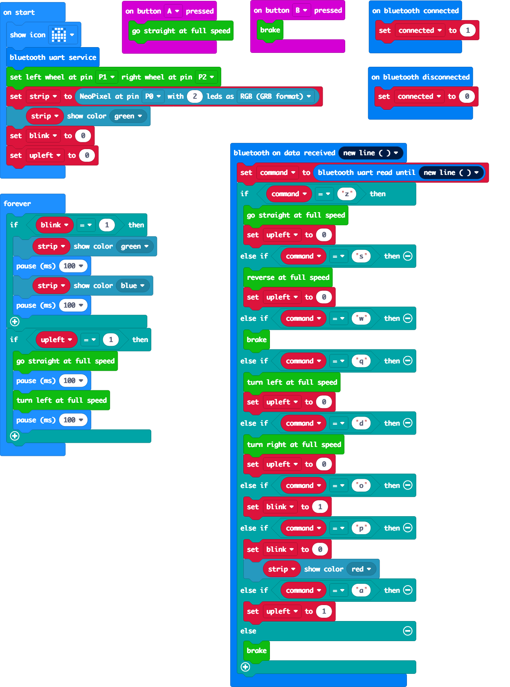

# board-explorer-makecode

The micro:bit side of [board-explorer](https://github.com/storagebits/board-explorer): a MakeCode program that receives one-letter commands over Bluetooth Low Energy and drives a ring:bit car and its two RGB LEDs.



## What it does

On start, the micro:bit shows a ghost icon, opens the Bluetooth UART service, sets up the ring:bit car (wheels on pins P1 and P2) and lights its two NeoPixel LEDs (pin P0) green. It then waits for lines on the Bluetooth UART, sent by board-explorer from an arcade joystick:

| Command | Action |
|---|---|
| `z` | go forward at full speed |
| `s` | reverse at full speed |
| `q` | turn left |
| `d` | turn right |
| `w`, or anything else | brake |
| `o` | make the LEDs blink green and blue |
| `p` | show green |

Button A also drives forward and button B brakes, to test the car without Bluetooth.

## Status

Prototype from 2020, no longer developed. Provided as is, mostly for educational use.

- Worked in 2020 (not re-tested on hardware since): the commands above, sent by board-explorer from a USB joystick.
- Known bug: `p` shows green but does not clear the `blink` flag, so once `o` has been received the LEDs keep blinking.
- The `upleft` branch of the forever loop is never triggered (the variable is always 0).
- The MakeCode build workflow (`.github/workflows/makecode.yml`) targets Node.js 8 and has not run in years; expect it to fail.

## Getting started

Requirements: a BBC micro:bit, an [Elecfreaks ring:bit car](https://www.elecfreaks.com/learn-en/microbitKit/ring_bit_v2/), and a browser.

- **Flash it as is:** open https://makecode.microbit.org/_frdR5xctm0Rt, then **Download** and copy the `.hex` file to the micro:bit.
- **Edit it:** open https://makecode.microbit.org/, click **Import**, then **Import URL**, and paste `https://github.com/storagebits/board-explorer-makecode`.
- **Use it as an extension:** in a new MakeCode project, open **Extensions** from the gear menu and search for `https://github.com/storagebits/board-explorer-makecode`.
- **Command line** (optional, needs [pxt](https://github.com/microsoft/pxt)): `make build`, `make deploy`, `make test`.

Then run board-explorer on the Raspberry Pi with this micro:bit's name; see its [README](https://github.com/storagebits/board-explorer#getting-started).

## Configuration

`pxt.json` declares the dependencies (`core`, `bluetooth` and `RingbitCar` from `tinkertanker/pxt-ringbitcar` v3.0.3) and opens Bluetooth pairing (`"open": 1`: no pairing needed, so any nearby device can connect). Pins are set in `main.ts`: wheels on P1 and P2, two NeoPixel LEDs on P0.

## Project layout

```
main.blocks, main.ts, main.py   the program (blocks, and its TypeScript and Python views)
pxt.json                        MakeCode project: dependencies, Bluetooth settings
test.ts                         empty test file
.github/makecode/               rendered blocks images
Makefile, Gemfile, _config.yml  MakeCode command-line and GitHub Pages scaffolding
```

## Licence and credits

Released under the [MIT licence](LICENSE). The project scaffolding (Makefile, Pages and workflow files) comes from the Microsoft MakeCode extension template (MIT). Depends on [pxt-ringbitcar](https://github.com/tinkertanker/pxt-ringbitcar) by Tinkercademy (MIT) and Microsoft's [pxt-neopixel](https://github.com/microsoft/pxt-neopixel) (MIT), fetched by MakeCode.

#### Metadata (used by MakeCode for search and rendering)

<!-- Kept at the very end on purpose: MakeCode reads these lines to list and render the extension. -->

* for PXT/microbit
<script src="https://makecode.com/gh-pages-embed.js"></script><script>makeCodeRender("{{ site.makecode.home_url }}", "{{ site.github.owner_name }}/{{ site.github.repository_name }}");</script>
